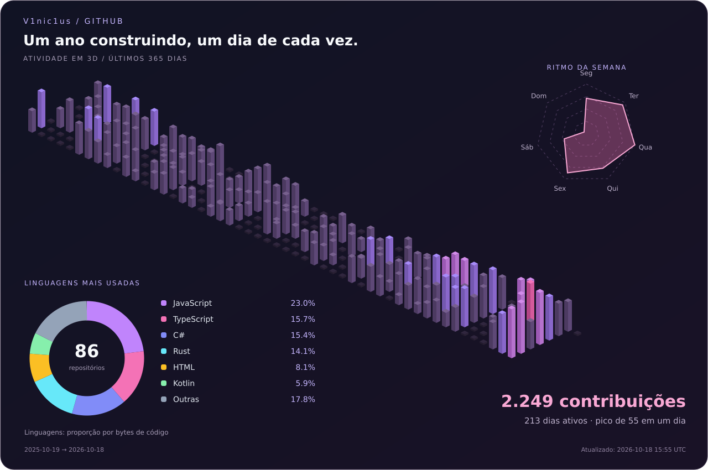
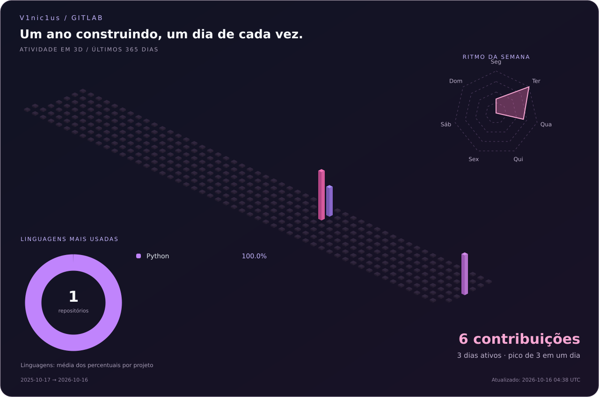

# Oii, eu sou o Marcus Vinícius 👋

**`V1nic1us` · Desenvolvedor Front-end & Mobile**

Entre interfaces web, aplicativos mobile e mais uma customização no Linux.

---

### `~/marcus $ whoami`

Sou o Marcus, mas por aqui pode chamar de **V1nic1us**. Sou **desenvolvedor front-end e mobile** e já atuei como **QA (Quality Assurance)**, com experiência em qualidade de software e automação de testes. Meu perfil reúne o que faz parte do meu universo: interfaces web, aplicativos, Linux e um pouco de anime e games.

- 🧪 **Experiência anterior em QA:** automação de testes com Playwright, Cypress e pytest.
- 💻 **Front-end:** desenvolvimento de interfaces web com HTML, CSS, JavaScript e TypeScript.
- 📱 **Mobile:** desenvolvimento de aplicativos com Kotlin e Jetpack Compose.
- 🐧 **Linux:** Pop!_OS, Ubuntu, Arch, Mint e Zorin estão no repertório.
- 🎮 **Fora do código:** games na Steam, leitura de livros e projetos de IoT com Raspberry Pi.

### `~/marcus $ cat stack`

**Linguagens**

**Desenvolvimento & testes**

### `~/marcus $ activity --3d --github --gitlab`

Um ano de atividade em blocos 3D, com as linguagens dos meus **repositórios públicos autorais**, sem forks.

GitHub: proporção por bytes de código. GitLab: média dos percentuais dos projetos com linguagens detectadas. Os blocos mostram a atividade diária do perfil e o radar mostra o ritmo por dia da semana. Cada plataforma tem seu próprio ranking; projetos espelhados podem aparecer nos dois. Coleta programada para cada 12 horas após ativar a automação.

### `~/marcus $ snake --commits`

<picture>
  <source media="(prefers-color-scheme: dark)" srcset="https://raw.githubusercontent.com/V1nic1us/V1nic1us/output/github-contribution-grid-snake-dark.svg" />
  
</picture>

### `~/marcus $ social --links`

---

### `~/marcus $ reading --current`

📚 **Na minha mesa de leitura**

- **Estruturas de Dados** — leitura em andamento.
- **Algoritmos** — leitura em andamento.
- **Guia de Raspberry Pi para Iniciantes** — leitura em andamento.
